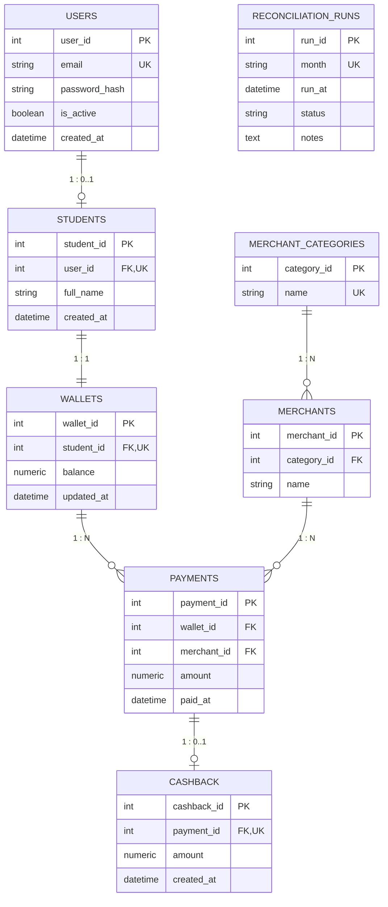

# FinPay Database Design & Entity Relationship Specification

## 1. Relational Entities (3NF Normalized)

As specified in the approved Lab 4 Detailed Design (`FinPay_Lab4_Detailed_Design_Filled(1).docx`), FinPay uses one relational database as the single source of truth across eight normalized entities.

## 2. Table Definitions & Constraints

### 2.1 USERS
- `user_id`: Primary Key (Autoincrement).
- `email`: VARCHAR(255) UNIQUE NOT NULL (Index).
- `password_hash`: VARCHAR(255) NOT NULL (Never exposed via API).
- `is_active`: BOOLEAN DEFAULT TRUE NOT NULL.
- `created_at`: TIMESTAMP WITH TIME ZONE DEFAULT NOW().

### 2.2 STUDENTS
- `student_id`: Primary Key (Autoincrement).
- `user_id`: Foreign Key referencing `users.user_id` UNIQUE NOT NULL (1:0..1).
- `full_name`: VARCHAR(255) NOT NULL.
- `created_at`: TIMESTAMP WITH TIME ZONE DEFAULT NOW().

### 2.3 WALLETS
- `wallet_id`: Primary Key (Autoincrement).
- `student_id`: Foreign Key referencing `students.student_id` UNIQUE NOT NULL (1:1).
- `balance`: NUMERIC(12, 2) NOT NULL DEFAULT 0.00.
- `updated_at`: TIMESTAMP WITH TIME ZONE DEFAULT NOW().

### 2.4 MERCHANT_CATEGORIES
- `category_id`: Primary Key (Autoincrement).
- `name`: VARCHAR(100) UNIQUE NOT NULL.

### 2.5 MERCHANTS
- `merchant_id`: Primary Key (Autoincrement).
- `category_id`: Foreign Key referencing `merchant_categories.category_id` NOT NULL.
- `name`: VARCHAR(255) NOT NULL.

### 2.6 PAYMENTS
- `payment_id`: Primary Key (Autoincrement).
- `wallet_id`: Foreign Key referencing `wallets.wallet_id` NOT NULL.
- `merchant_id`: Foreign Key referencing `merchants.merchant_id` NOT NULL.
- `amount`: NUMERIC(12, 2) NOT NULL (`CHECK (amount > 0)`).
- `paid_at`: TIMESTAMP WITH TIME ZONE DEFAULT NOW().

### 2.7 CASHBACK
- `cashback_id`: Primary Key (Autoincrement).
- `payment_id`: Foreign Key referencing `payments.payment_id` UNIQUE NOT NULL (1:0..1).
- `amount`: NUMERIC(12, 2) NOT NULL (`CHECK (amount >= 0)`).
- `created_at`: TIMESTAMP WITH TIME ZONE DEFAULT NOW().

### 2.8 RECONCILIATION_RUNS
- `run_id`: Primary Key (Autoincrement).
- `month`: VARCHAR(7) UNIQUE NOT NULL (Format: `YYYY-MM`).
- `run_at`: TIMESTAMP WITH TIME ZONE DEFAULT NOW().
- `status`: VARCHAR(50) NOT NULL.
- `notes`: TEXT NULL.
